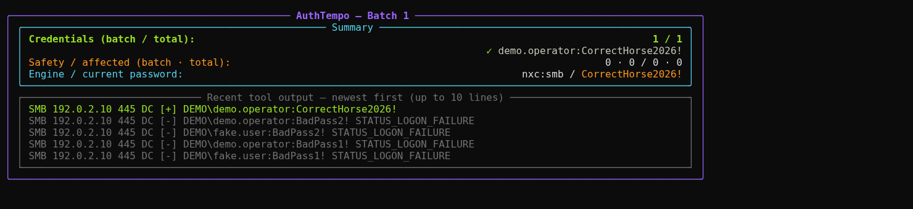
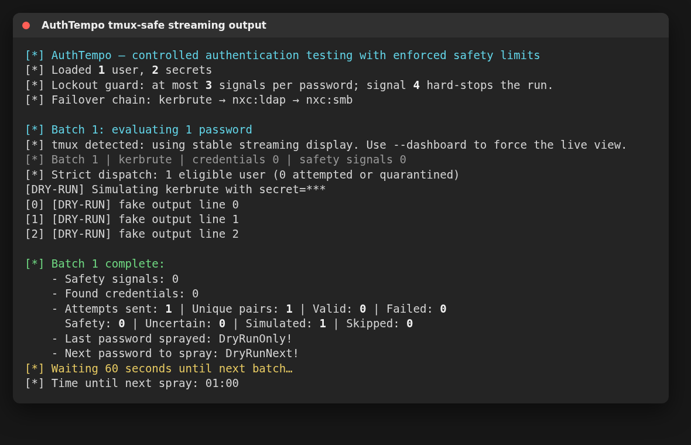
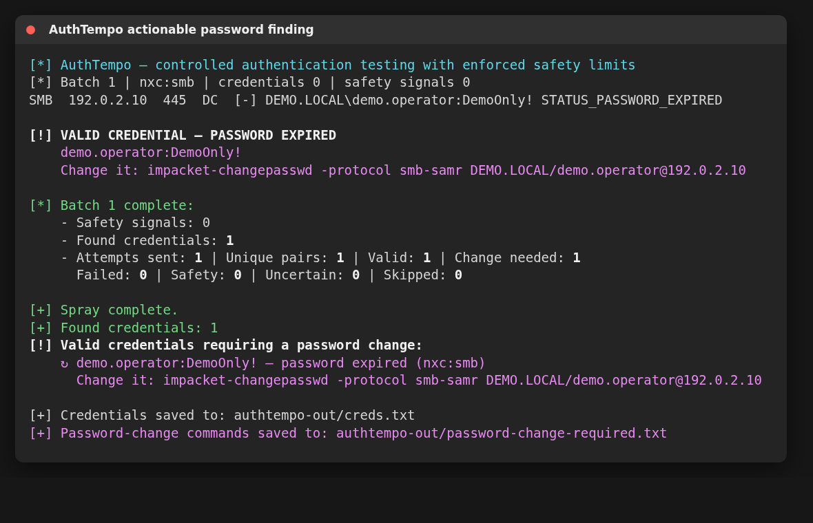

# AuthTempo

**Safe defaults for controlled password auditing.**

AuthTempo runs Kerbrute and NetExec with pacing, lockout stops, automatic tool failover, resumable state, and accurate attempt accounting. It is meant to feel simple during an assessment: provide users, passwords, a domain, and a domain controller; tune only when the engagement requires it.



*Live dashboard rendered from a local documentation fixture; no network authentication was sent.*

> Use only on systems you have explicit written permission to test.

## Get started

```bash
python3 -m venv .venv
source .venv/bin/activate
python -m pip install -e .

# Preview the whole workflow without sending authentication attempts
authtempo -u users.txt -p passwords.txt -d sevenkingdoms.local \
  -dc-ip 192.168.15.129 --dry-run

# Run with the safe defaults
authtempo -u users.txt -p passwords.txt -d sevenkingdoms.local \
  -dc-ip 192.168.15.129
```

The default run:

- tries Kerbrute first and fails over when a tool is genuinely unhealthy;
- tests one password across the user list, then waits 35 minutes;
- enforces a maximum of three lockout signals for one password and hard-stops on signal four (Kerbrute safe mode can stop earlier);
- stops testing users that are locked, compromised, or left in an uncertain state;
- highlights expired and forced-change passwords as valid, actionable findings;
- saves state after every meaningful change so `--resume` can continue safely;
- shows found credentials at the top of the dashboard and writes them immediately to `creds.txt`.

Confirm the effective domain and fine-grained lockout policies before a live run. AuthTempo reacts immediately to evidence it can observe, but no client can guarantee zero lockouts without the target’s policy and replication context.

## Everyday controls

The basic command is enough for most runs. These are the options worth remembering:

| Option | Meaning |
|---|---|
| `--tool kerbrute\|nxc` | Tool to try first; fallback is automatic |
| `--protocol ldap\|smb` | NetExec protocol; ignored by Kerbrute |
| `-t`, `--wait MINUTES` | Time to wait between password groups; default `35` |
| `--limit N` | Passwords tested across the user list before each wait; default `1` |
| `--max-lockouts N` | Hard-stop when one password produces more than `N` signals; default `3` |
| `--validate-users` | Check which usernames exist before testing passwords |
| `--pth` | Treat the password file as NTLM hashes and use NetExec |
| `--dry-run` | Exercise the workflow without target activity |
| `--resume` | Continue a compatible interrupted run |
| `--start-fresh` | Replace AuthTempo artifacts in the selected output directory |
| `-o`, `--output DIR` | Choose where state, logs, and findings are written |
| `--report json\|csv\|all` | Write machine-readable results |
| `--timeline` | Write a self-contained HTML activity view |

```bash
authtempo --help           # short operator help
authtempo --advanced-help  # scheduling, recovery, display, and troubleshooting
```

Older option names still work for existing scripts, including `--passes-per-batch`, `--engine`, and the former engine-tuning flags. New commands should use the shorter names above.

## Common runs

```bash
# NetExec over SMB
authtempo -u users.txt -p passwords.txt -d LAB -dc-ip 10.10.10.10 \
  --tool nxc --protocol smb

# Pass-the-hash
authtempo -u users.txt -p hashes.txt -d LAB -dc-ip 10.10.10.10 \
  --pth --protocol smb

# Two passwords per group, then a 45-minute wait
authtempo -u users.txt -p passwords.txt -d LAB -dc-ip 10.10.10.10 \
  --limit 2 --wait 45

# Reports and an HTML timeline
authtempo -u users.txt -p passwords.txt -d LAB -dc-ip 10.10.10.10 \
  --report all --timeline
```

## Terminal and tmux behavior

AuthTempo uses a compact, content-sized dashboard in a normal interactive terminal. It keeps credentials and safety counters at the top and shows only the 10 most recent raw-output lines by default; the complete feed remains in `authtempo.log`. Use `--raw-lines N` to change that window. Inside tmux it automatically switches to stable line-by-line output, avoiding cursor redraw problems while keeping raw tool output visible. `--dashboard` forces the live view and `--stream` forces line-by-line output; all three are listed under `--advanced-help`.



*Sanitized rendering of the tmux-safe streaming view; no network authentication was sent.*

## Findings and state

The default output directory is `./authtempo-out` (`./authtempo-dry-run-out` for a dry run).

| File | Purpose |
|---|---|
| `creds.txt` | Valid credentials, written as soon as they are found |
| `password-change-required.txt` | Expired/forced-change credentials and ready-to-run Impacket commands |
| `locked-out.txt` | Identities with definitive lockout evidence |
| `authtempo.state.json` | Resume state and reconciled attempt ledger |
| `authtempo.log` | Audit log and raw tool output |
| `used-passwords.txt` | Passwords that completed across the eligible user set |
| `results.json` | Optional statistics, findings, and pair-level outcomes |
| `results.csv` | One row per recorded identity/password pair, including failures and retries |
| `authtempo-timeline.html` | Optional run summary, per-pass activity, findings, and event timeline |

The output directory and sensitive artifacts are created with private permissions. They can contain plaintext credentials and should be handled as engagement evidence.

When Active Directory reports an expired password or requires a change, AuthTempo highlights the credential separately and prepares a prompt-safe command such as:

```bash
impacket-changepasswd -protocol smb-samr LAB/alice@10.10.10.10
```

Enter the recorded current password and the new password when prompted. The command is also saved in `password-change-required.txt`.



*Sanitized password-expired finding using documentation-only credentials and addresses.*

## Targeted password lists

The included helper builds a bounded list from the organization and domain you supply:

```bash
python3 password_mutator.py -d sevenkingdoms.local \
  --org "Seven Kingdoms" --count 150 -o passwords.txt
```

Its seasons, years, suffixes, anchors, common passwords, and leet substitutions live in `wordlists/` as editable text files. See [Password mutator guide](docs/PASSWORD_MUTATOR.md) for examples and all options.

## Install the authentication tools

Python 3.10 or newer is required. Install at least one engine; both are recommended for failover.

```bash
# NetExec
pipx install git+https://github.com/Pennyw0rth/NetExec

# Kerbrute
go install github.com/ropnop/kerbrute@latest
```

For exact lockout behavior, recovery rules, input parsing, compatibility names, and every advanced option, see the [operator reference](docs/OPERATOR_REFERENCE.md).

## License

Same as the original `spraygun.sh` project.
